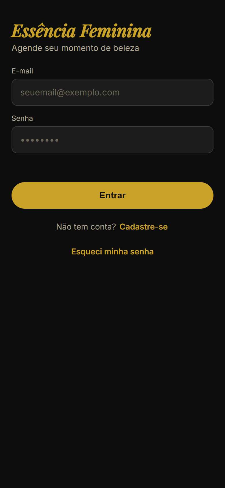
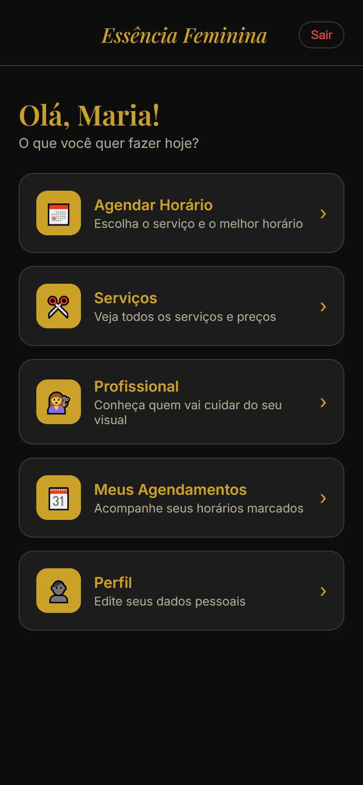
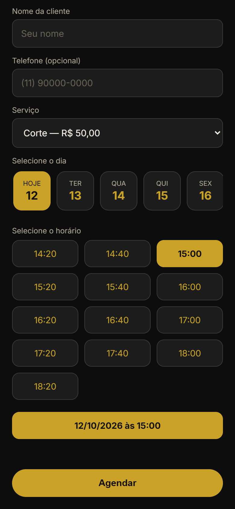
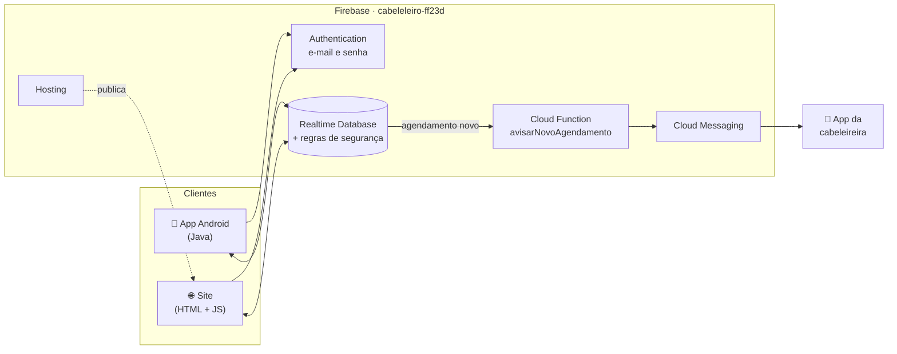

<div align="center">


# Essência Feminina

**Sistema de agendamento do salão de beleza: app Android e site, no mesmo banco de dados.**

[](cabeleleiro/)
[](cabeleleiro/)
[](https://firebase.google.com/)
[](https://cabeleleiro-ff23d.web.app)
[](site-agendamento/testes-regras/regras.test.js)

[Site de agendamento](https://cabeleleiro-ff23d.web.app) · [App Android](cabeleleiro/) · [Site e Cloud Functions](site-agendamento/)

</div>

---

## Sobre

As clientes marcam horário **pelo app Android ou pelo site**. A cabeleireira
acompanha e organiza a agenda pelo app, e recebe um aviso no celular a cada
agendamento novo. Os dois lados usam o mesmo projeto Firebase. Assim, um
horário reservado no site já aparece ocupado no app na mesma hora, e o
contrário também.

## Telas do site

<div align="center">

| Login | Menu da cliente | Agendar horário |
|:---:|:---:|:---:|
|  |  |  |

<sub>Capturas no tamanho de um celular, com dados de exemplo.</sub>

</div>

## Funcionalidades

### Para a cliente (app e site)

- Cadastro e login com e-mail e senha, e recuperação de senha por e-mail
- Agendamento por serviço: o sistema só mostra os horários em que o serviço
  **cabe inteiro**, respeitando a duração de cada um e os dias em que o salão abre
- Editar, reagendar ou cancelar os próprios agendamentos
- Consultar serviços, preços e a profissional
- Editar o próprio perfil
- Lembrete no celular antes do horário marcado (app)

### Para a cabeleireira (app)

- Agenda completa do salão, com opção de marcar atendimentos como concluídos
- Agendamento de encaixe
- Cadastro e edição de serviços, preços e duração
- Escolha dos dias de funcionamento
- Aviso no celular (push) a cada agendamento novo, feito pelo app ou pelo site

## Arquitetura



**Como a reserva de horário funciona:** o dia é dividido em blocos de 20
minutos. Ao agendar, o app ou o site grava, **numa única operação atômica**,
o agendamento e todos os blocos que o serviço ocupa. Se outra pessoa reservou
algum desses blocos um instante antes, a gravação inteira é recusada pelo
banco. Por isso duas clientes nunca ficam com o mesmo horário.

> [!IMPORTANT]
> A regra de horário livre existe **duas vezes**: em Java (`BancoController`)
> e em JavaScript (`index.html`). Toda mudança precisa ser feita nos dois
> lados, conforme [`.claude/rules/sincronia-app-site.md`](.claude/rules/sincronia-app-site.md).

## Tecnologias

| Parte | Tecnologias |
|---|---|
| App Android | Java 8, Android SDK 34 (mínimo Android 7.0), Material Components, WorkManager, Firebase Auth, Realtime Database e Messaging |
| Site | HTML, CSS e JavaScript num arquivo só, sem framework e sem build; Firebase JS SDK (compat) |
| Backend | Firebase Realtime Database, Authentication, Hosting e Cloud Functions 2ª geração (Node 22) |
| Testes | Emulador do Firebase com 49 casos para as regras de segurança |

## Estrutura do repositório

```text
.
├── cabeleleiro/                 App Android (cliente e cabeleireira)
│   ├── app/src/main/java/…      Activities e controllers (BancoController, UsuarioController…)
│   ├── app/src/main/res/        Layouts, cores e ícones
│   └── CLAUDE.md                Schema do banco, regras e decisões do app
├── site-agendamento/            Site da cliente e backend
│   ├── index.html               O site inteiro
│   ├── database.rules.json      Regras de segurança do banco (fonte oficial)
│   ├── testes-regras/           Testes automáticos das regras (emulador)
│   ├── functions/               Cloud Function de aviso de novo agendamento
│   ├── .well-known/             assetlinks.json (liga o site ao app, App Link)
│   ├── firebase.json            Configuração de Hosting, Database e Functions
│   └── CLAUDE.md                Deploy, functions e App Link
├── docs/telas/                  Capturas de tela usadas neste README
└── CLAUDE.md                    Visão geral e regras do projeto
```

## Banco de dados

| Caminho | Conteúdo | Quem acessa |
|---|---|---|
| `usuarios/{uid}` | nome, telefone, e-mail, `tipo` (cliente ou cabeleireira) | só a dona do perfil |
| `agendamentos/{id}` | lista completa de agendamentos | cabeleireira lê tudo; cliente grava só os dela |
| `agendamentos_por_cliente/{uid}/{id}` | cópia dos agendamentos de cada cliente | só a própria cliente |
| `horarios_ocupados/{data}/{bloco}` | uid de quem reservou cada bloco de 20 min | qualquer pessoa logada lê |
| `servicos/{id}` | nome, preço, duração | todas leem; só a cabeleireira grava |
| `configuracoes/diasFuncionamento` | dias em que o salão abre | todas leem; só a cabeleireira grava |

Descrição completa em [`cabeleleiro/CLAUDE.md`](cabeleleiro/CLAUDE.md).

## Segurança

As permissões ficam nas regras do banco
([`database.rules.json`](site-agendamento/database.rules.json)), e não no
app nem no site. Mesmo quem tentar acessar o banco por fora dos dois fica
sujeito a elas:

- Ninguém se cadastra como cabeleireira nem consegue se promover depois.
  O `tipo` do perfil não pode ser alterado nem apagado.
- Uma cliente não vê dados de outras clientes.
- Um horário só pode ser reservado com o próprio uid, e só por quem
  reservou pode ser liberado (a cabeleireira pode tudo).
- Um agendamento de cliente só é aceito se o horário for reservado **na
  mesma gravação**. A cliente não marca o próprio atendimento como concluído.
- Serviços, preços e dias de funcionamento só são alterados pela cabeleireira.
- O site exibe os dados do banco sempre como texto puro, sem `innerHTML`.
- Arquivos internos (`*.md`, regras, configuração e testes) ficam fora do
  site publicado.

> [!NOTE]
> A `apiKey` do Firebase que aparece no site e no `google-services.json` é
> **pública por natureza**: ela identifica o projeto, não dá acesso a nada. O que
> protege os dados são as regras acima.

## Desenvolvimento

### Pré-requisitos

- [Android Studio](https://developer.android.com/studio) (com o JDK embutido)
- [Node.js](https://nodejs.org/) e [Firebase CLI](https://firebase.google.com/docs/cli) (`npm install -g firebase-tools`)
- Java instalado (para o emulador do Firebase)

### App Android

Abra a pasta `cabeleleiro/` no Android Studio. Para gerar o APK que vai para as clientes:

```bash
cd cabeleleiro
./gradlew assembleRelease
# saída: app/build/outputs/apk/release/app-release.apk
```

> [!WARNING]
> O APK release é assinado com a chave guardada em `cabeleleiro/assinatura.keystore`
> e `cabeleleiro/keystore.properties`. Esses arquivos **não ficam no repositório**
> e têm cópia de segurança separada. Sem eles o build para com uma mensagem
> explicando o que falta. Sem a mesma chave, as clientes não conseguem atualizar
> o app por cima da versão instalada.

A cada versão nova, aumente `versionCode` e `versionName` em
`cabeleleiro/app/build.gradle.kts`.

### Site

O site é um único `index.html`, sem etapa de build. Para ver no computador:

```bash
cd site-agendamento
npx http-server -p 5000 .
# abrir http://127.0.0.1:5000
```

> [!CAUTION]
> Mesmo rodando no computador, o site se conecta ao **banco de produção**. Não
> crie contas nem agendamentos de teste com dados falsos.

### Testar as regras do banco

Antes de qualquer mudança em `database.rules.json`:

```bash
cd site-agendamento
firebase emulators:exec --only database --project demo-teste "node testes-regras/regras.test.js"
```

Os testes rodam num banco temporário no próprio computador e simulam as
mesmas gravações do app e do site, além de tentativas de abuso. O resultado
esperado é `TODOS OS TESTES PASSARAM`.

## Publicação

Tudo roda no projeto Firebase **de produção**, com clientes reais. Use sempre
`--only`: um `firebase deploy` sozinho publicaria site, regras e functions de
uma vez.

| O quê | Comando (em `site-agendamento/`) | Antes de publicar |
|---|---|---|
| Site | `firebase deploy --only hosting` | conferir o `ignore` do `firebase.json` e o `assetlinks.json` |
| Regras do banco | `firebase deploy --only database` | rodar os testes; conferir que ninguém mudou as regras pelo Console |
| Cloud Function | `firebase deploy --only functions` | `npm install` em `functions/` |

O passo a passo detalhado, com os problemas já resolvidos, está em
[`site-agendamento/CLAUDE.md`](site-agendamento/CLAUDE.md).

## Documentação do projeto

Os arquivos `CLAUDE.md` guardam o contexto técnico completo: schema, decisões
tomadas, bugs conhecidos e cuidados. Foram escritos para quem for mexer no
código, seja uma pessoa ou um assistente de IA.

| Arquivo | Assunto |
|---|---|
| [`CLAUDE.md`](CLAUDE.md) | Visão geral e regras gerais |
| [`cabeleleiro/CLAUDE.md`](cabeleleiro/CLAUDE.md) | App Android, schema do banco e regras de segurança |
| [`site-agendamento/CLAUDE.md`](site-agendamento/CLAUDE.md) | Site, Cloud Functions, deploy e App Link |
| [`.claude/rules/`](.claude/rules/) | Regras de sincronia app↔site, segurança do Firebase e convenções Android |

---

<div align="center">
<sub>Projeto privado do salão Essência Feminina. Todos os direitos reservados.</sub>
</div>
